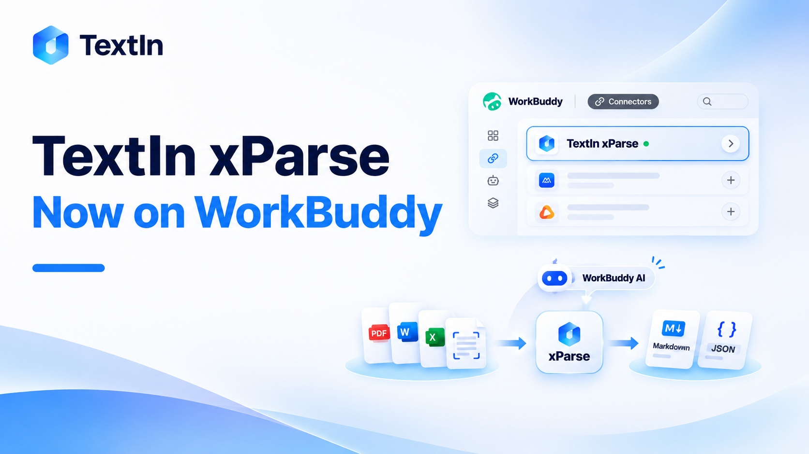
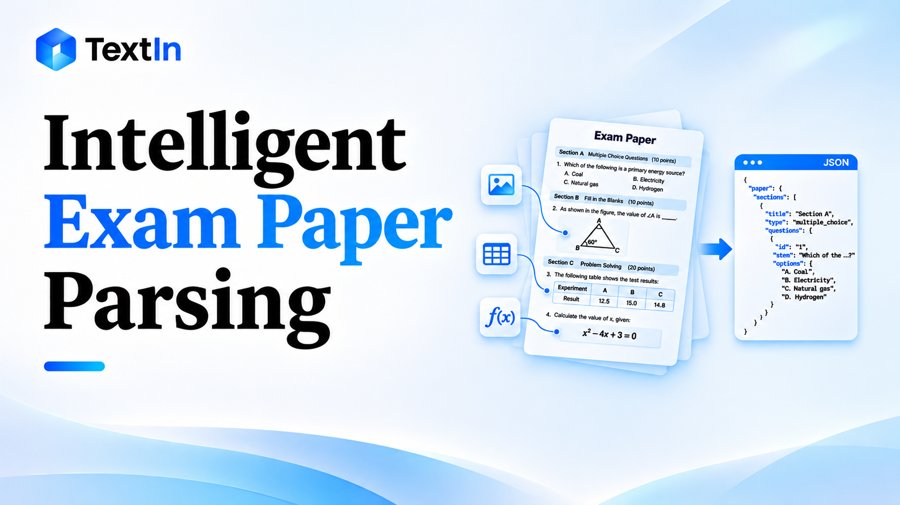

<section className="home-hero">
<h1>Document AI resources: Blog and Case Studies</h1>
Engineering guides, practical insights, and proven customer workflows for turning complex documents into structured, usable data.

<a className="site-button" href="/news/list">Explore the Blog</a><a className="site-button site-button--outline" href="/cases/list">Read Case Studies</a>

</section>

<a className="home-portal portal-journal" href="/news/list">
<h2>Blog</h2>
Engineering deep dives and practical guides on document parsing, table and form extraction, and retrieval-ready data preparation.

Explore the Blog<svg width="20" height="20" viewBox="0 0 24 24" fill="none" stroke="currentColor" strokeWidth="1.6" strokeLinecap="round" strokeLinejoin="round"><path d="M4 12h15m-6-6 6 6-6 6" /></svg>
</a>
<a className="home-portal portal-stories" href="/cases/list">
<h2>Case Studies</h2>
How teams use TextIn to automate document workflows, improve accuracy, and unlock business value.

Read Case Studies<svg width="20" height="20" viewBox="0 0 24 24" fill="none" stroke="currentColor" strokeWidth="1.6" strokeLinecap="round" strokeLinejoin="round"><path d="M4 12h15m-6-6 6 6-6 6" /></svg>
</a>

<section className="home-latest" data-home-section="news">

<h2>Latest from the Blog</h2><a href="/news/list">Explore the Blog</a>

  <a className="home-article-link" href="/news/20260805101419355">
    

    

      
TechnicalAug 5, 2026

      <h2>TextIn xParse Is Now Available as a WorkBuddy Connector: Helping WorkBuddy Understand Your Documents </h2>
      
TextIn xParse is now available as a WorkBuddy connector, enabling high-accuracy structured parsing of complex documents. Process 100-page PDFs in approximately 2 seconds, helping AI agents understand documents and automate tasks.

      
4 min read

    

  </a>

  <a className="home-article-link" href="/news/20260806165623929">
    

    

      
TechnicalAug 7, 2026

      <h2>Intelligent Exam Paper Parsing: A Practical Guide to Automated Question Extraction </h2>
      
Built with TextIn xParse and LLMs, this solution extracts question groups, question stems, tables, and images, with cross-page reconstruction and structured JSON output for question banks and digital learning.

      
4 min read

    

  </a>

</section>
<section className="home-latest" data-home-section="cases">

<h2>Case Studies</h2><a href="/cases/list">Read Case Studies</a>

  <a className="home-article-link" href="/cases/20260109165413680">
    

    

      

Webasto

      
ManufacturingAutomotiveJan 9, 2026

      <h2>How Webasto Cut Invoice Processing Time by 95% with TextIn</h2>
      
TextIn brought Chinese, Japanese, and Korean supplier invoices into one automated accounts payable workflow at Webasto&#39;s Asia-Pacific shared services center, reducing average processing time from 5 minutes to just 15 seconds.

      

<strong>15 sec</strong>average supplier invoice processing time

    

  </a>

  <a className="home-article-link" href="/cases/20260120144502796">
    

    

      

SPDB Financial Leasing

      
Financial servicesJan 20, 2026

      <h2>How SPDB Financial Leasing Scaled Contract Operations with TextIn</h2>
      
Processing around 200,000 contracts annually, SPDB Financial Leasing uses TextIn to automate data extraction and integrate structured data with its core business systems.

      

<strong>1.45M+</strong>cumulative system calls at publication

    

  </a>

  <a className="home-article-link" href="/cases/20260515161812188">
    

    

      

A Chinese Heavy-equipment Manufacturer

      
ManufacturingMay 15, 2026

      <h2>How Chinese Heavy-equipment Manufacturer Built a Shared Document Layer for AI with TextIn xParse</h2>
      
A heavy equipment manufacturer uses TextIn xParse to turn complex business documents—from engineering drawings and overseas repair manuals to contracts and audit reports—into structured data for use across its operations.

      

<strong>70%</strong>improvement in management report analysis

    

  </a>

</section>
<section className="resource-cta"><h2>Put document AI to work.</h2><a className="site-button" href="https://www.textin.ai/contact">Talk to our team</a></section>

