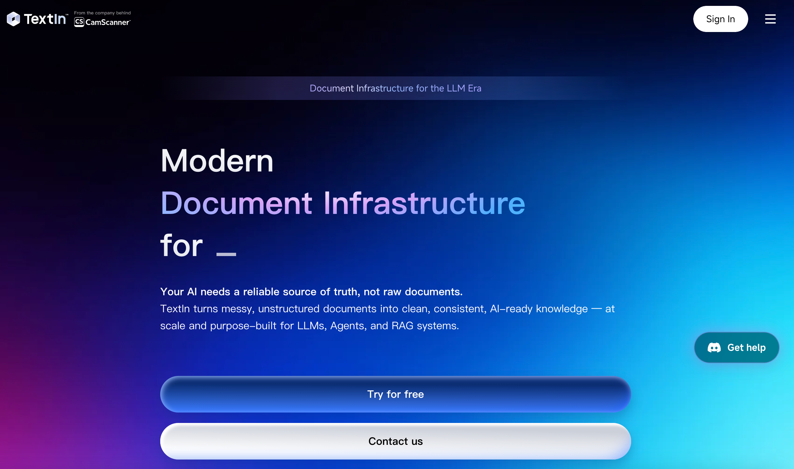
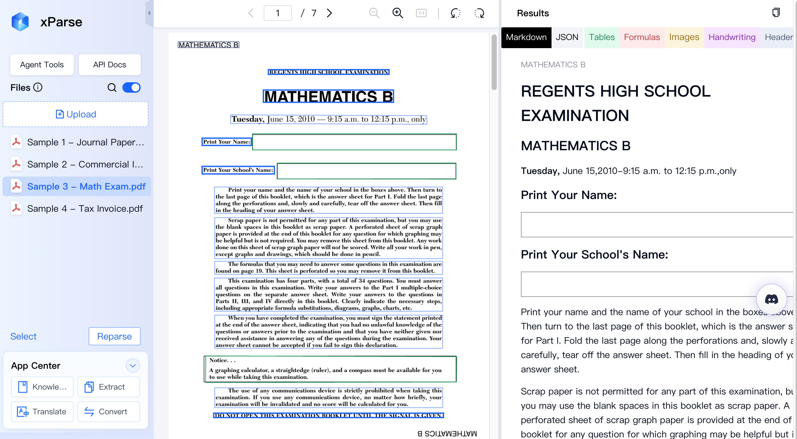

{/* content:metadata:start */}

[Back to Blog](/news/list)

Technical · xParse · Nov 18, 2026

{/* content:metadata:end */}

TextIn xParse delivers high-speed document processing through proprietary parsing-speed optimizations, **parsing 100-page documents in about 2 seconds.**

|  | P50 (100 pages) | P90 (100 pages) | P95 (100 pages) | P99 (100 pages) | Average (per page) |
| :-- | --: | --: | --: | --: | --: |
| **TextIn** | **1.46s** | **1.75s** | **2.07s** | **2.62s** | **0.015s** |

P50 represents the median response time. This means that half of all test samples have a response time below the P50 value, while the other half have a response time above it. Similarly, P90 represents the 90th percentile response time. In this performance test, this means that 90% of document parsing operations were completed within 1.75 seconds, reflecting the experience of most users.

## 1. Why Do We Need Faster Document Parsing?

### 1.1 Enabling Big Data Applications

We can take financial big data applications as an example.

For financial data providers, processing large volumes of data within a short period is a common requirement. To provide timely and accurate big data queries and retrieval services, companies have clear requirements for T+0 database updates during periods of frequent data updates, such as the annual financial and reporting seasons. They also maintain high standards for data quality.

Traditional data entry first requires data cleaning and the use of extensive regular expressions to extract content from web pages. However, traditional methods are ineffective when dealing with document-based data. Documents in various formats and with complex layouts often conceal important information, making it difficult to efficiently and accurately convert that information into usable data.

As enterprise applications of large language models continue to gain traction, the financial big data industry is undergoing a transformation. Currently, the combination of "Data + Document Parsing + LLM + Prompt" is becoming a preferred approach.

Compared with writing regular expressions, prompts are relatively easier to maintain and lower the barrier to use. Meanwhile, with the powerful reading, understanding, and generation capabilities of LLMs, professionals can improve content interpretation and data analysis. This simplifies the key challenge to one question: How can document content be converted into an LLM-friendly format that allows LLMs to read and analyze the data?

Our answer is a fast, stable, and reliable document parsing tool.

In financial big data applications, a good document parsing tool needs to offer the following capabilities. First, sufficient parsing speed: during periods of intensive data entry, data from newly released financial reports, annual reports, legal documents, and other files needs to be made available on the day of publication.

Second, accurate table structure recognition: reports often contain complex structures, including borderless tables, cross-page tables, merged cells, and dense tables. When extracting unstructured data, even a small error can lead to significant differences, and inaccurate input can affect database quality.

Third, good compatibility: the tool should be compatible with various document layouts and minimize parsing failures.

Speed is a key factor in efficient business operations. Generally, annual reports of listed companies often exceed 200 to 300 pages. **TextIn's document parsing technology can process the annual reports of thousands of companies within eight hours**, helping big data companies bring their data online.

### 1.2 Accelerating LLM Training

The performance of large language models largely depends on their ability to understand and generate human language. Given the complexity and diversity of natural language, this is a challenging task, making LLM training particularly important.

During training, deep learning models are exposed to massive volumes of text data to learn language patterns, semantics, and contextual relationships. This enables them to understand and generate natural language, supporting applications such as translation, conversation, question answering, and text generation.

The quality of LLM training has a decisive impact on model performance and applications. With high-quality training, large models can perform better in tasks such as semantic understanding and text reasoning. In addition to sufficient computing resources, high-quality data is one of the most important factors in achieving high-quality LLM training. Put simply, the data fed into a large model determines the performance of the LLM.

Fast and accurate document parsing tools can effectively accelerate the LLM training process.

On the one hand, accurate recognition of complex layouts and good format compatibility can improve the quality of pre-training data. On the other hand, LLM pre-training datasets often contain tens of millions of pages. Currently, using **30 million pages of PDF documents** as an example, the processing time for commonly used tools is close to two weeks. **Based on the processing speed of the current TextIn version, the same volume is expected to be parsed within five working days, saving more than a week.**

In today's AI-driven era, where efficiency is paramount, saving more than a week can play a critical role in developers' R&D cycles. **A good document parsing tool can serve as an "accelerator" for LLM development and applications.**

### 1.3 Improving the End-User Experience

Currently, the user experience of document-based Q&A applications still needs improvement. For example, when users upload large scanned documents or books, the files often exceed the document size limits of LLMs, or parsing fails after a lengthy loading process.

Meanwhile, due to limitations in network speed and computing resources, waiting for document parsing after uploading a file is common in LLM-powered Q&A applications. Generally, parsing can take anywhere from more than ten seconds to several minutes, which is a common experience for users.

For end users, fast and stable document parsing can also significantly improve the user experience, removing barriers posed by scanned documents and complex layouts in LLM-powered Q&A applications, helping LLMs retrieve more accurate information and ultimately improving the quality of answers.

## 2. Try the Latest TextIn xParse Document Parsing Tool

Developers can visit the TextIn global website, register an account, and try the latest version of TextIn xParse.

Visit: [https://www.textin.ai/xparse](https://www.textin.ai/xparse?from=news-article-261118)

Click **Try for free** to access the product experience.

If you want to try making API calls, you can also refer to the corresponding API documentation:

[https://docs.textin.ai/xparse/parse/quickstart](https://docs.textin.ai/xparse/parse/quickstart?from=news-article-261118)

The quickstart guide walks you through setting up your API credentials, making a parsing request, and retrieving the returned Markdown and structured elements.

If you want to use Python, you can refer to the general code examples provided on the platform.

The document parsing product offers a free trial quota of 1,000 credits. We also welcome you to connect with our team, share your feedback, and make suggestions.

---

## Keep exploring

<CardGroup cols={2}>
  <Card title="RAGFlow x TextIn Integration 2.0 Is Now Live" href="/news/20260416141504142">
    xParse · Announcements
  </Card>

  <Card title="Intelligent Exam Paper Parsing: A Practical Guide to Automated Question Extraction" href="/news/20260806165623929">
    xParse · Technical
  </Card>
</CardGroup>

{/* content:footer:start */}

[Back to Blog](/news/list)

<Card title="Put document AI to work." href="https://www.textin.ai/contact" cta="Talk to our team">
</Card>

{/* content:footer:end */}
