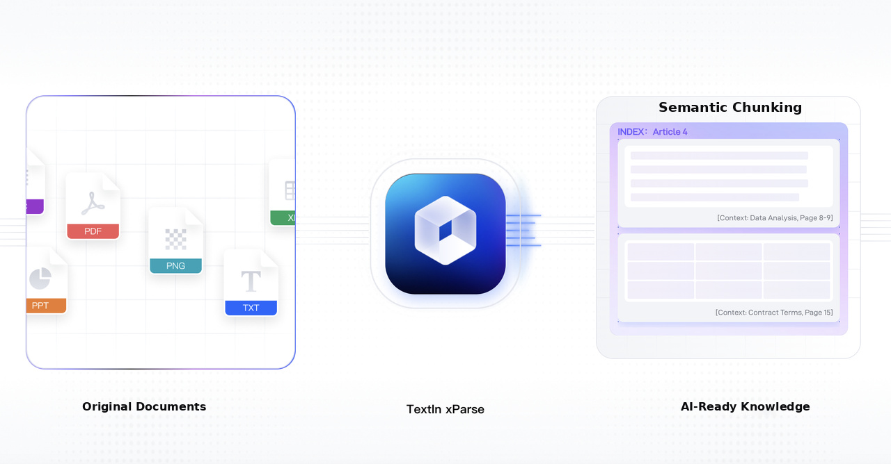
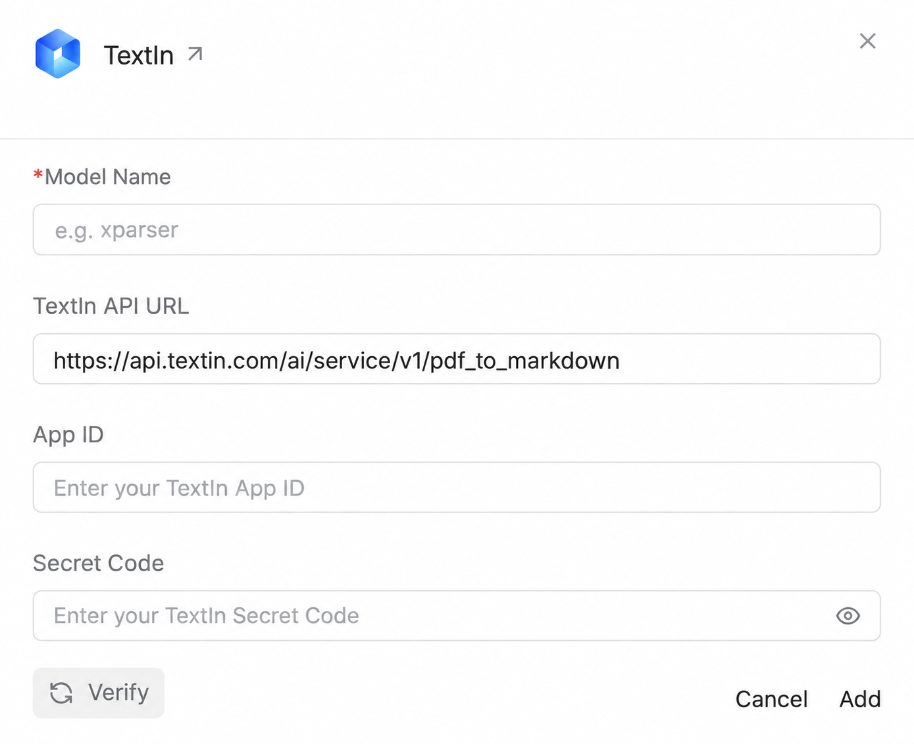
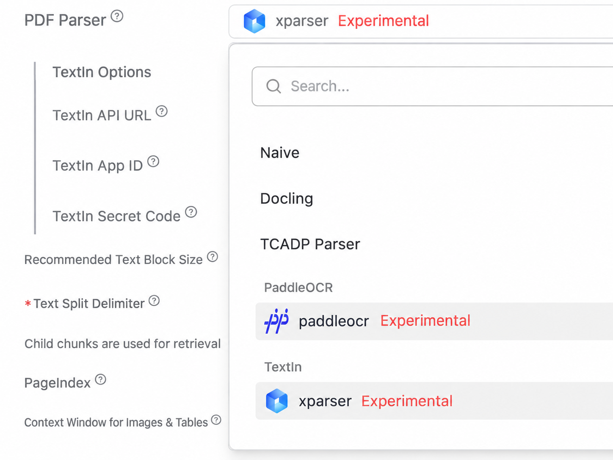

{/* content:metadata:start */}
[Back to Blog](/news/list)

Announcements · xParse · Apr 16, 2026
{/* content:metadata:end */}

## 📝 Project Overview

**Based on RAGFlow v0.24.0 | Plugin-Based Integration**

This project is an enhanced version of RAGFlow that integrates TextIn's intelligent document parsing capabilities to deliver more accurate and reliable PDF document understanding.

TextIn is INTSIG's cloud-based document intelligence platform. Powered by AI, it accurately extracts text, tables, charts, and mathematical formulas from documents.



**GitHub:** [https://github.com/intsig-textin/xparse-ragflow](https://github.com/intsig-textin/xparse-ragflow)

### Design Principles

- **Plugin-Based Integration** — New functionality is maintained independently without disrupting RAGFlow's original code structure.
- **Minimal Code Changes** — Modifications to existing files are limited to the necessary routing integration.
- **Easy Maintenance** — Makes it easier to keep up with upstream RAGFlow releases.
- **Flexible Switching** — Switch back to the official version or use other parsing engines at any time.

## **✨** Core Features

<table>
  <colgroup>
    <col width="283" />
    <col width="470" />
  </colgroup>
  <thead>
    <tr>
      <th>Feature</th>
      <th>Description</th>
    </tr>
  </thead>
  <tbody>
    <tr>
      <td>🎯 High-Accuracy Parsing</td>
      <td>Powered by TextIn's cloud-based AI to improve parsing accuracy for complex documents.</td>
    </tr>
    <tr>
      <td>📊 Intelligent Table Recognition</td>
      <td>Accurately extracts complex table structures, including tables spanning multiple pages.</td>
    </tr>
    <tr>
      <td>🖼️ Chart and Image Extraction</td>
      <td>Automatically identifies and extracts charts and images from documents.</td>
    </tr>
    <tr>
      <td>🔢 Formula Recognition</td>
      <td>Accurately recognizes and extracts mathematical formulas.</td>
    </tr>
    <tr>
      <td>🌐 Cloud-Based Processing</td>
      <td>No local GPU required. High-performance parsing is delivered through API calls.</td>
    </tr>
    <tr>
      <td>🔌 Knowledge-Base-Level Configuration</td>
      <td>Different knowledge bases can use different parsing engines independently, without interfering with one another.</td>
    </tr>
  </tbody>
</table>

## 🚀 Quick Start

### Prerequisites

Before getting started, make sure you have:

1. ✅ A registered TextIn account ([https://www.textin.com/](https://www.textin.com/)) with API access enabled.
2. ✅ Your **App ID** and **Secret Code** from the [TextIn Console](https://www.textin.com/console/dashboard/setting).
3. ✅ The corresponding official version of RAGFlow installed locally.

⚠️ **Version Compatibility:** Make sure the deployed service image version matches the current tag in the GitHub repository to avoid version compatibility issues.

### 🇨🇳 China-Based Docker Image Acceleration

Users in China can use the following Alibaba Cloud images to accelerate deployment and improve image pull speeds.

<table>
  <colgroup>
    <col width="124" />
    <col width="245" />
    <col width="450" />
  </colgroup>
  <thead>
    <tr>
      <th>Service</th>
      <th>Official Image</th>
      <th>China-Based Image</th>
    </tr>
  </thead>
  <tbody>
    <tr>
      <td>RAGFlow</td>
      <td>`infiniflow/ragflow:v0.24.0`</td>
      <td>`crpi-2ix4w0sw61gwpv0x.cn-shanghai.personal.cr.aliyuncs.com/intsig_acg/ragflow:v0.24.0` ⚠️ Built from this repository's source code</td>
    </tr>
    <tr>
      <td>MySQL</td>
      <td>`mysql:8.0.39`</td>
      <td>`crpi-2ix4w0sw61gwpv0x.cn-shanghai.personal.cr.aliyuncs.com/intsig_acg/mysql:8.0.39`</td>
    </tr>
    <tr>
      <td>Elasticsearch</td>
      <td>`elasticsearch:8.11.3`</td>
      <td>`crpi-2ix4w0sw61gwpv0x.cn-shanghai.personal.cr.aliyuncs.com/intsig_acg/elasticsearch:8.11.3`</td>
    </tr>
    <tr>
      <td>MinIO</td>
      <td>`quay.io/minio/minio:RELEASE.2025-06-13T11-33-47Z`</td>
      <td>`crpi-2ix4w0sw61gwpv0x.cn-shanghai.personal.cr.aliyuncs.com/intsig_acg/minio:RELEASE.2025-06-13T11-33-47Z`</td>
    </tr>
    <tr>
      <td>Valkey</td>
      <td>`valkey/valkey:8`</td>
      <td>`crpi-2ix4w0sw61gwpv0x.cn-shanghai.personal.cr.aliyuncs.com/intsig_acg/valkey:8`</td>
    </tr>
  </tbody>
</table>

### ⚙️ Configuration

To use the China-based images, modify the following files.

#### 📄 Step 1: Modify `docker/.env` (RAGFlow Main Service Image)

Update line 157:

```bash
RAGFLOW_IMAGE=crpi-2ix4w0sw61gwpv0x.cn-shanghai.personal.cr.aliyuncs.com/intsig_acg/ragflow:v0.24.0
```

#### 📄 Step 2: Modify `docker/docker-compose-base.yml` (Dependency Service Images)

Update the corresponding image entries:

```yaml
# Line 5 - Elasticsearch
image: crpi-2ix4w0sw61gwpv0x.cn-shanghai.personal.cr.aliyuncs.com/intsig_acg/elasticsearch:8.11.3

# Line 178 - MySQL
image: crpi-2ix4w0sw61gwpv0x.cn-shanghai.personal.cr.aliyuncs.com/intsig_acg/mysql:8.0.39

# Line 205 - MinIO
image: crpi-2ix4w0sw61gwpv0x.cn-shanghai.personal.cr.aliyuncs.com/intsig_acg/minio:RELEASE.2025-06-13T11-33-47Z

# Line 227 - Valkey
image: crpi-2ix4w0sw61gwpv0x.cn-shanghai.personal.cr.aliyuncs.com/intsig_acg/valkey:8
```

## 📦 Installation

💡 Choose one of the following deployment methods based on your requirements.

### 🎯 Option 1: Use China-Based Prebuilt Images (Recommended)

✨ Suitable for quick deployment and production environments.

Follow the instructions in the **China-Based Docker Image Acceleration** section above to update the image addresses in `docker/.env` and `docker/docker-compose-base.yml`.

### 🔧 Option 2: Build from Source

🛠️ Suitable for scenarios that require code modifications or debugging.

#### 📥 Step 1: Clone the Repository and Build the Image

```bash
git clone https://github.com/intsig-textin/xparse-ragflow.git
cd xparse-ragflow
docker build -t your-image-name:tag -f Dockerfile .
```

#### ⚙️ Step 2: Configure the Image Name

Modify line 157 in `docker/.env`:

```bash
RAGFLOW_IMAGE=your-image-name:tag
```

## 🚀 Launch and Access

✅ After completing the configuration, run the following commands to start the services:

```bash
cd docker
DEVICE=gpu docker-compose up -d
```

### 🌐 Access the Interface

Once the services have started, open the following address in your browser:

```text
http://localhost:{SVR_WEB_HTTP_PORT}
```

💡 The default port is `80`. You can change it by configuring `SVR_WEB_HTTP_PORT` in `docker/.env`.

## 📘 User Guide

### 1. Configure the TextIn Parsing Engine

#### Step 1.1: Open Model Provider Settings

Log in to RAGFlow, click your profile avatar in the upper-right corner, and navigate to:

**User Settings → Model Providers**

#### Step 1.2: Add the TextIn Model

Locate the TextIn card, click **Add Model**, and enter the following configuration details:

| Configuration | Description | Example |
| :-- | :-- | :-- |
| Model Name | Custom name for identification | `xparser` or `textin-primary` |
| TextIn API URL | API endpoint (pre-filled by default) | `https://api.textin.com/ai/service/v1/pdf_to_markdown` |
| App ID | Obtain from the TextIn Console | `your_app_id` |
| Secret Code | Obtain from the TextIn Console | `your_secret_code` |



#### Step 1.3: Verify and Save

Click **Verify** to test the connection. Once verification succeeds, click **Add** to save the configuration.

### 2. Use TextIn in a Knowledge Base

#### Step 2.1: Create or Open a Knowledge Base

From the RAGFlow main interface, create a new knowledge base or open an existing one.

#### Step 2.2: Select the TextIn Parser

Go to the knowledge base's **Settings** page and locate the **PDF Parser** option.

In the **TextIn** section of the dropdown list, select the model you just added. It will be marked as **Experimental**.



Click **Save** to apply the configuration.

### 3. Parse PDF Documents

#### Step 3.1: Upload a Document

In the knowledge base, click **Upload Files** and select the PDF document you want to parse.

#### Step 3.2: Start Parsing

After the upload is complete, RAGFlow automatically uses the TextIn API to parse the document.

#### Step 3.3: View the Results

Once parsing is complete, open the document details page to view the extracted text, tables, and images.

## 🏗️ Architecture Overview

### Data Processing Workflow

```text
PDF Document
     |
     ▼
naive.py: by_textin()
(Document Processing Entry Point)
     |
     ▼
LLMBundle (OCR Type)
(TextIn Model Configured for the Knowledge Base)
     |
     ▼
TextInOcrModel
rag/llm/ocr_model.py
     |
     ▼
TextInParser
deepdoc/parser/textin_parser.py
     |
     ├── Calls the TextIn API
     └── Uses pdfplumber to render pages
     |
     ▼
(sections, tables, images)
(Output compatible with RAGFlowPdfParser)
     |
     ▼
Chunking Pipeline
(No modifications required)
```

**Key Design:** `TextInParser` inherits from `RAGFlowPdfParser` and maintains full output compatibility. No changes are required to downstream chunking or indexing processes.

### Code Change Overview

#### Backend Files

| File Path | Change Type | Description |
| :-- | :-- | :-- |
| `deepdoc/parser/textin_parser.py` | Added | Core TextIn parser implementation |
| `rag/llm/ocr_model.py` | Modified | Added the `TextInOcrModel` class |
| `rag/app/naive.py` | Modified | Added the `by_textin()` processing function |
| `rag/app/{book,laws,manual,one,presentation}.py` | Modified | Integrated the TextIn parsing route |
| `common/constants.py` | Modified | Added TextIn configuration constants |
| `common/parser_config_utils.py` | Modified | Added the `@textin` parser route |
| `conf/llm_factories.json` | Modified | Registered TextIn as a model provider |
| `api/db/services/tenant_llm_service.py` | Modified | Added automatic environment variable injection |
| `api/apps/llm_app.py` | Modified | Added TextIn API request handling |

#### Frontend Files

| File Path | Change Type | Description |
| :-- | :-- | :-- |
| `web/src/.../modal/textin-modal/` | Added | TextIn configuration modal component |
| `web/src/.../setting-model/hooks.tsx` | Modified | Added the `useSubmitTextIn` Hook |
| `web/src/.../setting-model/index.tsx` | Modified | Integrated the TextIn configuration modal |
| `web/src/constants/llm.ts` | Modified | Added TextIn factory constants |
| `web/src/assets/svg/llm/textin.svg` | Added | TextIn logo icon |
| `web/src/locales/*.ts` | Modified | Added multilingual text support |

## ❓ Frequently Asked Questions

### Q1: Will TextIn affect embedding models or the retrieval pipeline?

No. TextIn is only responsible for the PDF document parsing stage (OCR and layout analysis). Subsequent processes, including vector embedding, text chunking, and retrieval, remain completely unaffected.

### Q2: Does TextIn require local GPU resources?

No. TextIn performs document parsing entirely through cloud-based API calls. No OCR or layout recognition models are loaded locally, so there are no special hardware requirements.

### Q3: Does it support other file formats, such as Word and Excel?

Currently, only PDF files are supported.

This integration uses a plugin-based approach and applies to PDF files only when the TextIn engine is selected in the knowledge base settings. Other file formats, including Word and Excel, continue to use RAGFlow's original parsers without any changes to their behavior.

### Q4: Can TextIn and DeepDOC be used simultaneously?

Yes. PDF parsers are configured independently at the knowledge base level. Different knowledge bases can use different parsing engines, such as TextIn or DeepDOC, without interfering with one another.

### Q5: What happens if a TextIn API request fails? Is there a fallback mechanism?

There is currently no automatic fallback mechanism.

If a TextIn API request fails, the parsing task terminates with an error. We recommend testing the API connection using the model verification feature before use.

### Q6: How can I check TextIn API usage costs?

TextIn is a service billed based on API calls or the number of pages processed.

For specific charges, log in to the [TextIn Console](https://www.textin.com/console/dashboard) to check your account balance and billing details.

### Q7: How fast is parsing compared with local DeepDOC?

Parsing speed depends on document complexity and network conditions.

TextIn processes documents using cloud GPU clusters and is generally faster than a single local GPU when handling complex documents. However, network latency and API queue times should also be taken into account.

## 📊 Document Parsing Model Evaluation

This project provides a complete evaluation toolkit for comparing the actual performance of different document parsers, including TextIn, DeepDOC, and PaddlePaddle, through RAGFlow question-answering quality assessments.

👇 For the complete usage guide, configuration instructions, and examples, see:

**RAGFlow Document Parser Evaluation Toolkit**

[https://github.com/intsig-textin/xparse-ragflow/blob/main/test_qa/README.md](https://github.com/intsig-textin/xparse-ragflow/blob/main/test_qa/README.md)

## 🔬 Advanced Topics

### Parser Behavior

#### Content Type Mapping

The TextIn API returns a structured `detail` array. The parser processes different content types according to the following rules:

| Type | Sub-Type | RAGFlow Processing |
| :-- | :-- | :-- |
| `paragraph` | `text` / `text_title` / `header` / `footer` / `sidebar` / `image_title` / `catalog` | Added to `self.boxes` as text blocks for subsequent chunking. |
| `paragraph` | `table_title` | Associated with the nearest table and embedded in an HTML `<caption>` tag. |
| `table` | — | Converted into an HTML table and added to the `tbls` list. |
| `image` | `chart` / `figure`, etc. | Cropped from the PDF page and added to the `images` list. |

### Cross-Page Table Processing

TextIn uses the `split_section_page_ids` and `split_section_positions` fields to identify tables split across multiple pages.

The parser generates an independent position record for each segment, ensuring that all table segments are correctly highlighted in the RAGFlow UI.

### Coordinate System Conversion

The TextIn API uses a 144 DPI coordinate system, while RAGFlow uses 72 DPI.

The parser automatically converts coordinates as follows:

```python
ragflow_coord = textin_coord / 2.0
```

This ensures accurate document highlighting.

## Developer Guide

### Class Inheritance

```text
RAGFlowPdfParser (Base Class)
    |
    └── TextInParser
            |
            └── TextInOcrModel
```

File locations:

- `TextInParser`: `deepdoc/parser/textin_parser.py`
- `TextInOcrModel`: `rag/llm/ocr_model.py`

### Local Development

If you need to modify the TextIn integration code, follow these steps to set up your local development environment.

**Step 1: Clone the Repository**

```bash
git clone <repository-url>
cd ragflow
```

**Step 2: Install Dependencies**

```bash
uv sync --python 3.12 --all-extras
```

**Step 3: Start the Base Services**

```bash
docker compose -f docker/docker-compose-base.yml up -d
```

**Step 4: Configure Environment Variables**

```bash
cp docker/.env.example docker/.env
```

Edit `docker/.env` and add the TextIn configuration.

**Step 5: Start the Backend Service**

```bash
source .venv/bin/activate
export PYTHONPATH=$(pwd)
bash docker/launch_backend_service.sh
```

**Step 6: Modify and Test the Code**

```bash
# Modify files such as:
# deepdoc/parser/textin_parser.py

# Restart the service to verify the changes.
```

## 🔗 Related Links

### Official Resources

- **RAGFlow GitHub Repository:** [https://github.com/infiniflow/ragflow](https://github.com/infiniflow/ragflow)
- **RAGFlow Documentation:** [https://ragflow.io/docs](https://ragflow.io/docs)
- **TextIn Official Website:** [https://www.textin.com/](https://www.textin.com/)
- **TextIn API Documentation:** [https://docs.textin.com/xparse/parse-quickstart](https://docs.textin.com/xparse/parse-quickstart)

<Card title="Explore xParse for structured documents" href="https://www.textin.ai/xparse">
  Preserve the information your downstream AI application needs.
</Card>

---

## Keep exploring

<CardGroup cols={2}>
  <Card title="TextIn xParse Is Now Available as a WorkBuddy Connector" href="/news/20260805101419355">
    xParse · Announcements
  </Card>

  <Card title="Intelligent Exam Paper Parsing: A Practical Guide to Automated Question Extraction" href="/news/20260806165623929">
    xParse · Technical
  </Card>
</CardGroup>

{/* content:footer:start */}

[Back to Blog](/news/list)

<Card title="Put document AI to work." href="https://www.textin.ai/contact" cta="Talk to our team">
</Card>

{/* content:footer:end */}
