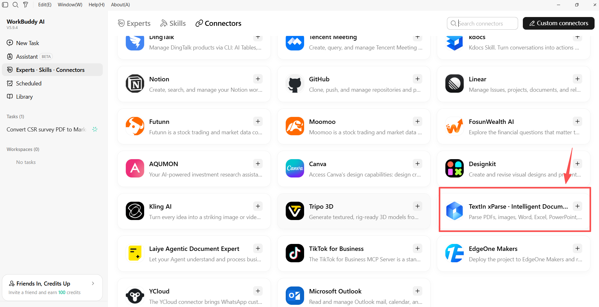
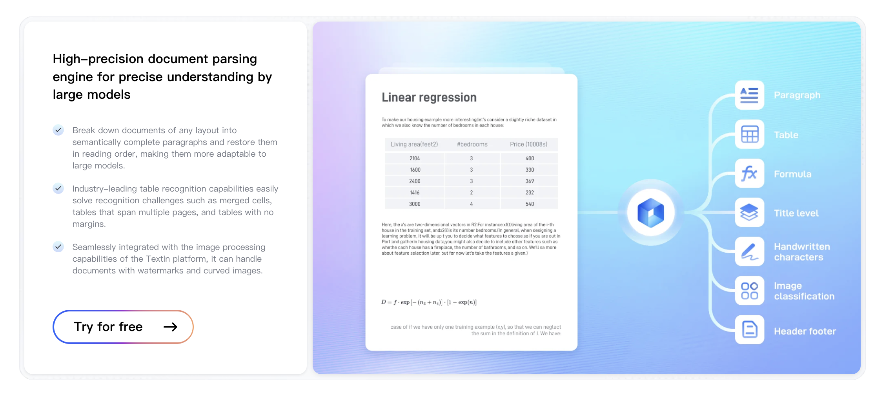
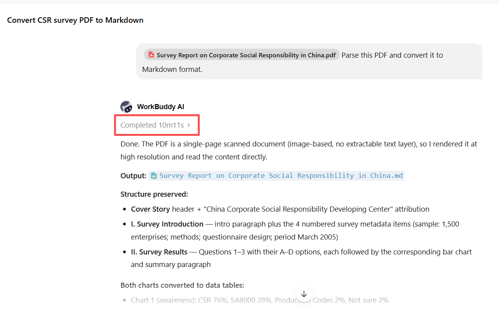
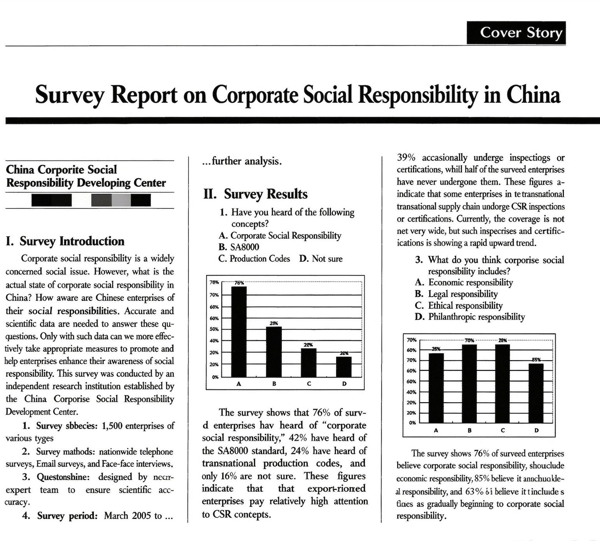
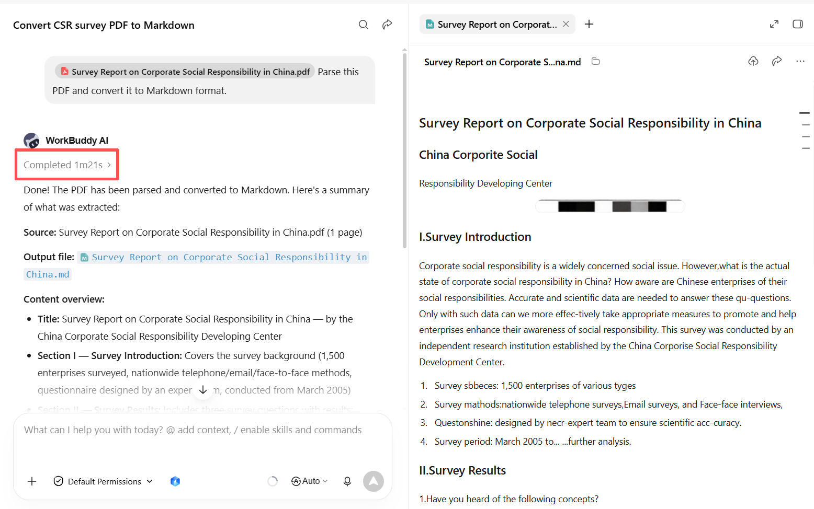
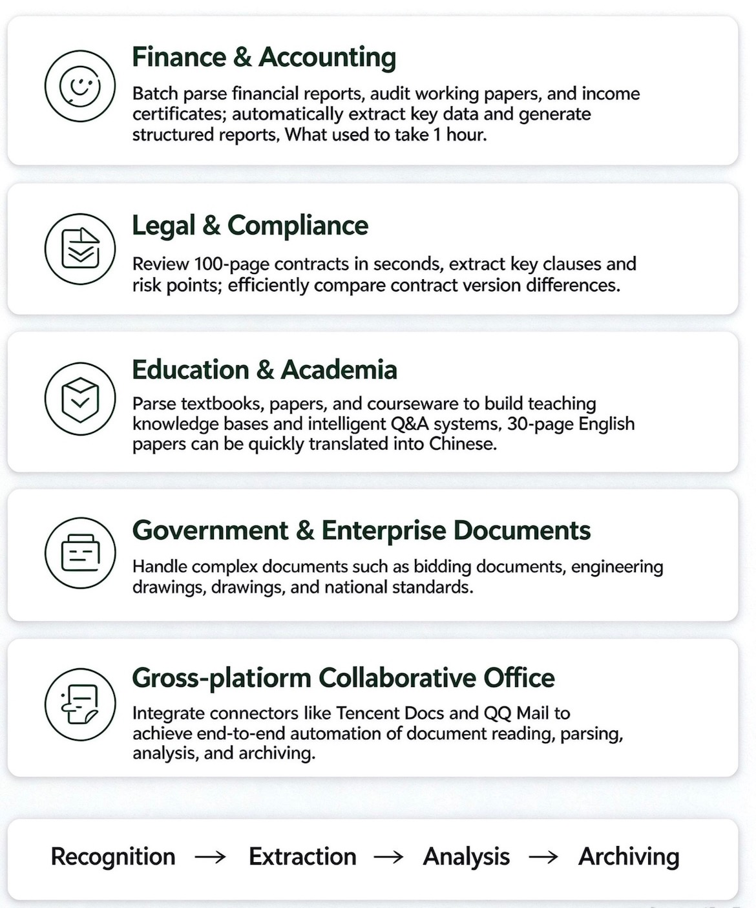

{/* content:metadata:start */}
[Back to Blog](/news/list)

Announcements · xParse · Aug 5, 2026
{/* content:metadata:end */}

A major free offering is now available for users who rely on AI agents to handle document-related tasks.

TextIn xParse is officially available as a WorkBuddy connector. WorkBuddy users can find TextIn xParse in the Connector Management page and enable it with a single click. With high-accuracy structured parsing, a 100-page PDF can be processed in approximately 2 seconds.

This means WorkBuddy can now understand your documents, whether they are encrypted PDFs, scanned files, multi-page tables, or documents with complex layouts. Simply describe what you need in natural language, and the parsing process is taken care of.

**WorkBuddy Connector + TextIn xParse = An AI Assistant That Understands Documents.**

## Why Does Document Parsing Matter?

In the era of large language models (LLMs), AI capabilities continue to expand. However, one fundamental bottleneck remains: processing unstructured documents.

In everyday business operations, vast amounts of information are stored in PDFs, Word documents, Excel spreadsheets, PowerPoint presentations, scanned files, and other document formats. Contracts contain critical clauses, financial reports hold essential figures, product manuals provide technical details, and research papers present valuable findings.

These documents contain business-critical information, but AI cannot always interpret their content and structure effectively without proper document processing.

Traditional OCR tools can only extract text line by line. They often fail to reconstruct document heading hierarchies, table structures, relationships between text and images, and content spanning multiple pages.

The resulting text is often disorganized and difficult for LLMs to interpret, leading to inefficient processing and inaccurate answers. A typical document workflow—from scanning and OCR to information extraction and database storage—often requires multiple tools and considerable integration code.

## What Can TextIn xParse Do?

TextIn xParse is a general-purpose document parsing service developed by INTSIG, backed by more than 20 years of experience in multimodal text intelligence. It is designed specifically for LLMs and enterprise AI applications.

More than a basic OCR tool, xParse provides a comprehensive document intelligence solution that efficiently transforms unstructured documents into structured, searchable, and analyzable data assets.

To date, xParse has served more than 1,000 enterprises worldwide, processing over one million pages of documents daily, with service availability of 99.99%. It is a recognized solution in China's document intelligence sector and a widely used document parsing tool across major Agent ecosystems, including OpenClaw and Dify.

### Key Capabilities of TextIn xParse

**📄 Broad Format Compatibility**

Supports more than 10 file formats, including PDFs (both digital and scanned), Word, Excel, PowerPoint, and images.

**🧩 Deep Structural Extraction**

Accurately identifies 16 types of document elements, including text, tables, images, headers and footers, mathematical formulas, and official seals. It automatically reconstructs heading hierarchies, seamlessly merges tables spanning multiple pages, and extracts chart axes and data values.

**🎯 High-Fidelity Document Reconstruction**

Understands and reconstructs document structures and element layouts to preserve accurate reading order. It is specifically optimized for complex documents with multi-column layouts and mixed text and images, such as academic papers, financial reports, contracts, and tender documents.

**⚡ High-Speed Processing**

Parses a 100-page PDF in approximately 2 seconds.

**📤 Standardized Output**

Exports parsing results directly in formats such as Markdown and JSON, making them ready for LLM integration without additional processing.

**🌍 Multilingual Support**

Supports text recognition in more than 50 languages, including Simplified Chinese, Traditional Chinese, English, major Western European languages, and major Eastern European languages.

## WorkBuddy + xParse: Better Together

### What Is WorkBuddy?

WorkBuddy is an all-in-one AI desktop workspace for professional tasks, developed by Tencent.

Its Connector feature acts as a bridge between WorkBuddy and external services through standardized protocols such as MCP (Model Context Protocol), enabling data exchange and expanded capabilities.

The core value of connectors is that AI assistants can directly access and interact with third-party services without requiring users to switch between tools manually, eliminating repetitive copy-and-paste workflows.

### Where Does Native Document Processing Fall Short?

WorkBuddy already provides basic document-reading capabilities. However, when handling complex documents in real-world business scenarios, its native processing capabilities can encounter several limitations:

- **Scanned documents and image-based PDFs:** The native solution relies on basic OCR to extract text but cannot fully reconstruct paragraph structures, table relationships, or reading order. The result is plain text stripped of its original structure, leaving AI to interpret the content with incomplete context.
- **Documents with complex layouts:** Multi-column academic papers, financial reports with cross-page tables, and tender documents combining text and images can all present challenges. Native parsing may result in disorganized content, broken tables across pages, and lost relationships between charts and their descriptions.
- **Large and lengthy documents:** Parsing speed can decrease significantly when processing PDFs exceeding 50 pages, sometimes resulting in timeouts or truncated content and missing information.

As illustrated in the examples above, complex scanned documents can cause the native solution to take longer to process, require multiple attempts with different approaches, and produce inconsistent parsing results.

### What Changes When xParse Is Integrated?

With xParse connected, users gain access to a high-accuracy document parser directly within WorkBuddy.

The workflow becomes straightforward:

- Users simply describe their requirements in natural language, such as "Convert this document into Markdown" or "Read this PDF contract and extract its key clauses."
- WorkBuddy calls xParse through the connector to perform fast, high-accuracy document parsing.
- Based on the structured data, WorkBuddy can automatically carry out subsequent tasks, including analysis, summarization, report generation, and automated archiving.

The entire process takes place within the WorkBuddy workspace, with no need to switch applications.

More importantly, xParse can work alongside other existing connectors to enable integrated workflows:

- **Tencent Docs:** Retrieve a weekly report draft from Tencent Docs → Parse it with xParse → Automatically generate a structured summary with AI → Save the results back to Tencent Docs.
- **QQ Mail:** Retrieve a contract attachment from QQ Mail → Use xParse to extract key contractual clauses → Automatically generate review comments with AI and draft an email response.

This enables AI agents to move beyond simple conversations toward end-to-end task execution across multiple services.

### Typical Use Cases

## Get Started

Get up and running in three simple steps, with no coding required:

1. Log in to WorkBuddy and click **Connectors** in the left navigation menu.
2. Find the **TextIn xParse** card and click **\+** to add it.
3. Start giving instructions in natural language. No code required.

TextIn xParse is currently available to all WorkBuddy users at no cost, with a daily parsing quota of 500 pages.This makes enterprise-grade document parsing accessible to every Agent user, helping AI agents complete tasks more reliably and efficiently.

**Learn More:** Visit the [TextIn](https://www.textin.ai/) or consult the official WorkBuddy documentation.

WorkBuddy can now understand your documents. Starting today, let AI read documents, organize data, and deliver insights for you.

Open WorkBuddy now and experience a more efficient way to process documents with TextIn xParse.

<Card title="Explore xParse for structured documents" href="https://www.textin.ai/xparse">
  Preserve the information your downstream AI application needs.
</Card>

---

## Keep exploring

<CardGroup cols={2}>
  <Card href="/news/20260813171405940">
  </Card>

  <Card href="/cases/20261016113656382">
  </Card>
</CardGroup>

{/* content:footer:start */}

[Back to Blog](/news/list)

<Card title="Put document AI to work." href="https://www.textin.ai/contact" cta="Talk to our team">
</Card>

{/* content:footer:end */}
