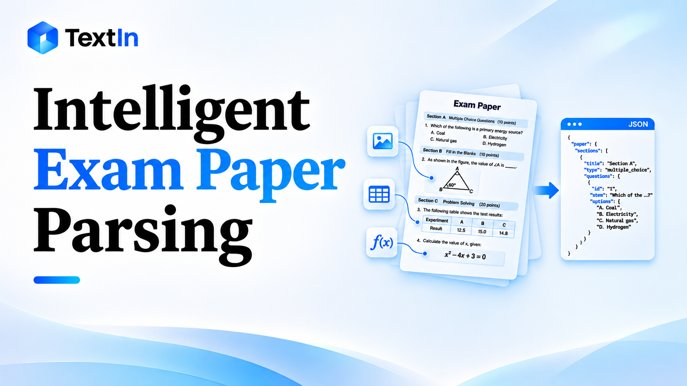

{/* content:metadata:start */}
[Back to Blog](/news/list)

Technical · xParse · Aug 7, 2026
{/* content:metadata:end */}



This project is an intelligent exam paper parsing tool designed for automated question bank development. It supports PDF files, scanned documents, and photos of exam papers taken with mobile phones. The tool can automatically process various question types, including multiple-choice questions, fill-in-the-blank questions, reading comprehension, mathematics problems, and listening comprehension.

It extracts structured information such as question group hierarchies, shared question stems, sub-questions, answer options, scores, and source page numbers, and outputs standardized JSON data. Key capabilities include cross-page question group reconstruction, table preservation, image association, compatibility with irregular document formats, and source traceability through original document coordinates.

The solution is suitable for a range of applications, including question bank development, automated homework grading, learning analytics, and the digitalization of educational materials.

**GitHub:** [https://github.com/intsig-textin/xparse-sample-projects](https://github.com/intsig-textin/xparse-sample-projects)

In scenarios such as question bank development, online education, and the digitalization of educational materials, exam papers remain one of the most important sources of data. For exam extraction tasks, where input formats are complex and output structures are highly constrained, the greatest value of a document parsing solution is not simply recognizing text. It is providing a sufficiently stable intermediate representation that allows LLMs and downstream processing rules to work from a more structured foundation.

Multiple-choice questions, fill-in-the-blank questions, reading comprehension, and mathematics problems may all appear in the same exam paper, but their layouts can vary significantly. More importantly, these documents are rarely clean digital files. Many originate from scanned paper exams or photos taken with mobile phones, often containing skewed pages, handwritten annotations, broken content across pages, and distorted tables.

If exam questions still have to be extracted manually—copying question stems, answer options, scores, and question numbers into a system one by one—the process is not only inefficient but also prone to missing shared question stems, cross-page question groups, and image associations.

The value of a mature exam extraction solution lies not in simply converting documents into text, but in organizing that text into structured data.

## Why OCR Alone Is Not Enough for Exam Paper Extraction

The main challenge in processing exam papers is not text recognition, but reconstructing the relationships between questions.

OCR can typically provide:

- Paragraph text
- Tables
- Images
- Page numbers
- Basic document hierarchy

However, downstream systems need much more:

- Which content belongs to the same question group?
- Which passage is a shared question stem, and which parts are individual sub-questions?
- Do images and tables belong to the question stem or to the answer options?
- How should question numbers, question types, and scores be structured?
- Does content spanning multiple pages belong to the same question?

This is a defining characteristic of exam paper extraction: the input is a layout-based document, while the output must be highly structured data. An additional layer of semantic understanding is therefore essential.

## A More Suitable Technical Architecture for Question Bank Applications

There are three common approaches to this type of task:

1. Rule-based extraction only
2. End-to-end LLM-based extraction
3. Document parsing as the foundation + LLM-based semantic extraction + backend normalization

**The third approach is recommended.**

Rule-based extraction is inherently fragile. Once question numbering formats, shared question stem patterns, or image placement methods change, existing rules can easily fail.

Pure end-to-end LLM extraction can be expensive, slow, and difficult to control. The model must understand both the document layout and the semantic relationships between questions. As a result, outputs are harder to verify, and page images, tables, and mathematical formulas are not easily reusable in subsequent workflows.

Combining document parsing with LLM-based extraction offers several advantages:

1. Document parsing first converts PDFs, images, and Word documents into a standardized intermediate representation, reducing differences between input formats.
2. The LLM focuses on semantic grouping and field identification, which are its core strengths, without having to repeat visual document understanding.
3. The backend can clean, merge, and validate model outputs, containing inconsistencies within the server-side processing layer.
4. OCR services and model services can be replaced independently, making the entire pipeline easier to maintain and evolve.

From an engineering perspective, this architecture separates deterministic processing from probabilistic processing.

## What Document Parsing Solves in This Pipeline

In this architecture, document parsing is more than simple OCR. It serves as the structured data foundation for the entire extraction pipeline.

For exam paper extraction, three types of output are particularly valuable:

- `markdown`**:** Improves readability and makes it easy to review the content of each page.
- `pages`**:** Provides page images and page-level positioning information.
- `detail`**:** The most important input for subsequent extraction. It typically preserves text block content, HTML tables, image URLs, page numbers, block types, and local positional information.

With this intermediate representation, the LLM no longer needs to process the original document directly. Instead, it works with content that has already been parsed and standardized.

For documents with complex layouts, such as exam papers, this is a critical prerequisite for extraction stability.

## A Practical End-to-End Implementation Workflow

To build a reliable exam extraction system, the following workflow is essential:

```text
Upload Document
    -> Document Parsing
    -> Reorganize Content by Page / Batch
    -> LLM-Based Question Group Extraction
    -> Backend Normalization and Merging
    -> Structured Output
```

The most important consideration is not the number of API calls, but ensuring that each layer handles what it does best:

- **Document parsing** converts files into a stable intermediate representation.
- **The LLM** understands semantic relationships between questions.
- **The backend** ensures that the output is usable and ready for database storage.

## Key Challenges and Implementation Strategies

### Challenge 1: Reconstructing Relationships Between Shared Question Stems and Sub-Questions

Exam papers frequently contain multiple questions based on a shared reading passage, or several sub-questions under a single mathematics problem. Although OCR can recognize the text, it cannot directly determine that these questions belong to the same group.

This is where LLMs can help identify question groups. However, the input must first be sufficiently clear and structured.

It is recommended to define the following constraints explicitly in the prompt:

- The output must use a `groups` structure.
- Each group may contain a `shared_stem` field.
- Each group must contain its corresponding `questions`.
- Sub-questions should not repeat the shared question stem.

The key is not simply asking the model to make a guess, but defining the question group structure as an explicit output contract.

### Challenge 2: Long Exam Papers Are Difficult to Process in One Pass, and Cross-Page Continuity Is Easily Lost

If an entire exam paper is sent to the model in a single request, several problems may arise:

- Excessively long input
- Slow response times
- The need to restart the entire extraction process when a request fails
- Loss of continuity when question groups span multiple pages

A more reliable approach is to process the document in page-based batches:

1. Group content from the `detail` output by `page_id`.
2. Add explicit page separators before each page's content.
3. Call the model separately for each batch.
4. Let the backend merge the results from multiple batches.

This project takes the approach a step further by providing a summary of the last question group from the previous batch as context for the next batch. The model can then use a `continues_previous` field to indicate whether the current content continues an existing question group.

This allows the backend to reconstruct question groups that span multiple pages.

This is one of the most technically important aspects of exam extraction: the challenge is not just extracting questions in a single pass, but maintaining continuity across multiple batches.

### Challenge 3: Images, Tables, and Mathematical Formulas Can Easily Lose Their Original Context

If images are replaced with descriptions such as "an image appears here," or tables are converted into plain text, the resulting question structure can become significantly less accurate.

A more suitable approach is to:

- Preserve images in their original `` format.
- Retain tables in HTML format.
- Preserve mathematical formulas in their original representations.

This allows the LLM to work with text structures that retain visual anchors, rather than simplified summary text.

For exam extraction, this directly affects:

- Correct image association in listening comprehension answer options
- Image association in mathematics problems
- Background information associated with table-based questions
- Semantic completeness of questions containing mathematical formulas

### Challenge 4: Model Outputs Are Inherently Inconsistent and Cannot Be Passed Directly to Downstream Systems

Even with carefully designed prompts, models may still produce:

- Missing fields
- Inconsistent data types
- Incorrectly populated null values
- Non-sequential group IDs
- Explanatory text mixed into JSON output

Therefore, an extraction system must include a backend normalization layer. At a minimum, it should handle:

- Fallback JSON parsing
- Field type validation and normalization
- Null value standardization
- Batch result merging
- Group ID renumbering

The reliability of an exam extraction system does not come from the model producing perfect output every time. It comes from the backend consistently handling and normalizing unstable outputs into a standardized structure.

### Challenge 5: Long-Running Tasks Need to Provide Users with Progress Updates

Exam extraction is not always an instantaneous process. When documents contain many pages or images, users may assume that the system has become unresponsive if no progress information is displayed.

A recommended approach is to implement a streaming task workflow:

- Return a `progress` event after each batch is completed.
- Return a `done` event when the entire task is finished.
- Return an `error` event if an error occurs.

This allows users to clearly understand the current status of the extraction process, including:

- Whether the document is being parsed
- Whether question extraction is in progress
- Which batch is currently being processed
- Whether the task has been completed

Although progress feedback is not necessarily an algorithmic advantage, it is essential for practical usability.

## A Structured Exam Data Schema Ready for Database Integration

The extraction results should ideally be standardized into a consistent schema that can be directly integrated into downstream systems. For example:

```json
{
  "paper_title": "...",
  "paper_meta": {
    "subject": "Mathematics",
    "grade_level": "High School",
    "exam_type": "Midterm",
    "has_images": true
  },
  "groups": [
    {
      "group_id": "G1",
      "section": "II. Reading Comprehension",
      "shared_stem": "...",
      "questions": [
        {
          "number": "21",
          "type": "Reading Comprehension",
          "score": 2,
          "stem": "...",
          "options": [],
          "source_page": 3
        }
      ],
      "source_pages": [3]
    }
  ],
  "warnings": []
}
```

The value of this structure is that it supports both frontend display and direct integration into downstream workflows, including question bank storage, quality inspection, data export, and manual correction.

## The Real Value of Intelligent Exam Paper Parsing

Intelligent exam paper parsing is not simply about replacing traditional OCR with a more sophisticated model. It is about restructuring how exam data enters business systems.

From an efficiency perspective, this approach delivers three main improvements:

1. It transforms the manual organization of question relationships into an automated structured extraction process.
2. It upgrades fragile, rule-based workflows that break when document layouts change into a more robust hybrid architecture.
3. It converts exam paper files directly into structured data that downstream systems can consume, rather than stopping at the OCR text extraction stage.

In the long run, the value of this approach goes beyond reducing the time required for manual question extraction. It enables exam data to enter question bank management, grading, and learning analytics workflows in a consistent and structured format.

Only when documents are properly understood and structured can more advanced intelligent education services be built on a reliable foundation.

👉 **GitHub:** [https://github.com/intsig-textin/xparse-sample-projects](https://github.com/intsig-textin/xparse-sample-projects)

The approach described above is a practical implementation of exam paper parsing based on document parsing, page-based batch extraction, and backend normalization.

The core idea is to first process low-quality exam documents—including scanned files, mobile photos, and exam papers with content spanning multiple pages—through layout-aware document parsing. This produces a standardized intermediate representation that preserves tables, images, block types, and coordinate information.

The content is then processed by an LLM in page-based batches to identify question group structures. Finally, the backend handles cross-page question group reconstruction and field normalization, producing JSON output with a consistent schema.

The solution has been published on GitHub, and we welcome developers to explore the project and exchange ideas.

If you encounter more complex document layouts in real-world exam processing scenarios, or have alternative architectural approaches to share, feel free to click the technical discussion group entry on the right side of the page and join the conversation.

<Card title="Explore xParse for structured documents" href="https://www.textin.ai/xparse">
  Preserve the information your downstream AI application needs.
</Card>

---

## Keep exploring

<CardGroup cols={2}>
  <Card title="TextIn xParse Is Now Available as a WorkBuddy Connector" href="/news/20260805101419355">
    xParse · Announcements
  </Card>

  <Card title="RAGFlow x TextIn Integration 2.0 Is Now Live" href="/news/20260416141504142">
    xParse · Announcements
  </Card>
</CardGroup>

{/* content:footer:start */}
[Back to Blog](/news/list)

<Card title="Put document AI to work." href="https://www.textin.ai/contact" cta="Talk to our team">
</Card>

{/* content:footer:end */}
