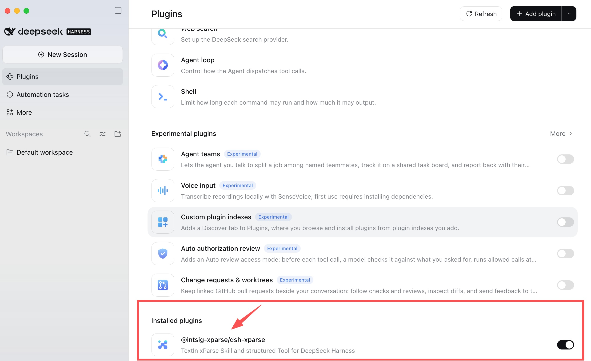
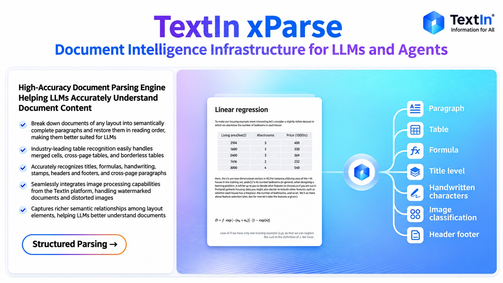
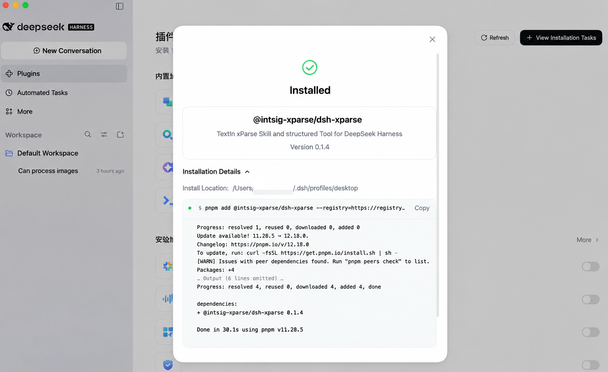
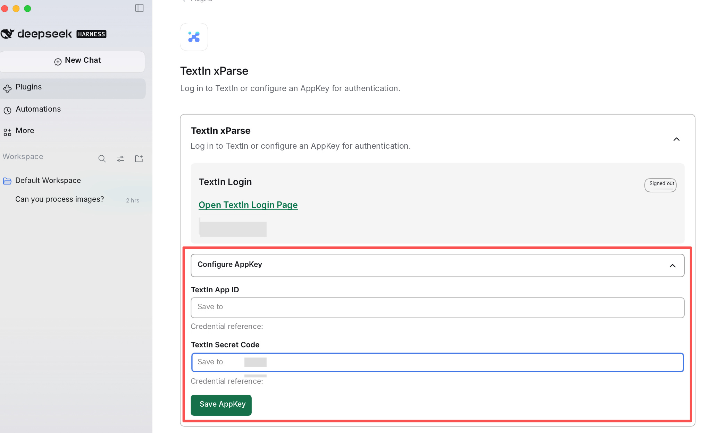

{/* content:metadata:start */}
[Back to Blog](/news/list)

Announcements · xParse · Nov 12, 2026
{/* content:metadata:end */}

TextIn xParse document parsing is now available in the DeepSeek Harness plugin ecosystem, providing professional support for developers building Agent applications with document processing capabilities.

Developers can call xParse within Agent workflows and flexibly combine relevant tools and skills according to their development needs, integrating document parsing into Agent task execution.



## 01 DeepSeek Harness: A Plugin-Based Framework for Agent Development

DeepSeek Harness is an open-source framework from DeepSeek for building and running AI Agents. It organizes the components required during Agent runtime and coordinates tool calls and task execution. Built on the Cordis plugin system, it adopts an "Everything Is a Plugin" architecture, modularizing models, tools, skills, sessions, sandboxes, storage, and other capabilities for flexible composition and extension.

**Plugin-Based Architecture for Flexible Agent Extension**

DeepSeek Harness uses the Cordis framework to manage plugin loading, unloading, and dependencies. Individual plugins contribute different capabilities to the Agent runtime.

Developers can install, replace, or build plugins according to project requirements without directly modifying the framework's core source code, making it easier to extend an Agent's available tools and skills.

**Multiple Runtime Modes for Development and Debugging**

DeepSeek Harness provides several runtime modes, including Standard, PTC, Minimal, and Creator, supporting different development and execution requirements.

It also provides a Trajectory view that allows developers to inspect model interactions, tool calls, and execution results, making Agent execution easier to understand, trace, and debug.

This open, plugin-based architecture provides a flexible foundation for integrating third-party tools and continuously extending Agent capabilities.

## 02 TextIn xParse: Professional AI Document Parsing

TextIn xParse is a general-purpose document parsing service developed by INTSIG, built on more than 20 years of expertise in multimodal text intelligence. It converts unstructured content—including PDFs, Office documents, images, and scanned files—into structured data that LLMs can more easily understand and process.

Rather than simply extracting text, xParse uses multimodal text intelligence to recognize and process text, tables, images, and document layout information. It supports standardized output formats such as Markdown and JSON, preserving document content and structural relationships to provide a reliable data foundation for downstream model processing.

As Agent ecosystems continue to evolve, document parsing is becoming an important link between unstructured data and Agent toolchains. TextIn xParse continues to expand its technical integrations across LLM, RAG, and Agent environments, making structured document data available for model understanding, retrieval, and subsequent processing.



### TextIn xParse Core Capabilities

**📄 Full-Format Compatibility**

Supports more than 10 file formats, including PDF (both digital and scanned), Word, Excel, PowerPoint, and images.

**🧩 Deep Structural Parsing**

Accurately recognizes 16 types of document elements, including text, tables, images, headers and footers, mathematical formulas, and stamps. It can reconstruct heading hierarchies, merge tables spanning multiple pages, and extract chart axes and values.

**🎯 High-Fidelity Layout Reconstruction**

Understands and reconstructs document structures and element relationships while preserving reading order. It is optimized for complex documents featuring multi-column layouts and mixed text-and-image content, including academic papers, financial reports, contracts, and tender documents.

**⚡ Fast Parsing**

A 100-page PDF can be parsed in as little as 2 seconds.

**📤 Standardized Output**

Parsing results can be exported in formats such as Markdown and JSON, making them readily available to LLMs and downstream applications without repeated format conversion.

**🌍 Multilingual Recognition**

Supports text recognition in more than 50 languages, including Simplified Chinese, Traditional Chinese, English, and major Western and Eastern European languages.

## 03 TextIn xParse × DeepSeek Harness: Expanding Agent Tool Capabilities

The TextIn xParse plugin integrates a structured `xparse` Tool, the accompanying `xparse-parse` Skill, and a built-in xParse CLI execution component, bringing professional document parsing capabilities into Agent workflows through the DeepSeek Harness plugin architecture.

### Tool + Skill Collaboration for Expanded Agent Tool Capabilities

The plugin combines Tool and Skill components, bringing together specific tool operations and task execution guidance to provide Agents with more comprehensive document parsing capabilities.

The structured `xparse` Tool provides document processing operations, including document parsing, document information retrieval, content search, and task management, which Agents can call according to their task requirements. The accompanying `xparse-parse` Skill provides usage guidance related to xParse document parsing, helping Agents understand the corresponding tool invocation methods and task execution requirements.

By integrating these components, the plugin reduces the need for developers to configure tool invocation logic separately and provides greater convenience when extending and orchestrating Agent capabilities according to project requirements.

### Built-in CLI Execution Component for Simplified Environment Configuration

In terms of execution environment, the TextIn xParse plugin integrates the xParse CLI, which is internally invoked by the Tool.

After installing the plugin, developers do not need to install a separate global xParse CLI or download execution components through installation scripts or network requests at runtime. The Tool always calls the corresponding binary bundled within the plugin package and does not depend on external programs in the system PATH.

This integration packages the tool invocation interface and execution components together, reducing additional environment configuration and dependency management. Developers can access xParse through the standard plugin installation process without separately handling CLI deployment and maintenance, simplifying the integration of professional document parsing into Agent development environments.

### Structured Task Management for Greater Development Flexibility

In addition to basic document parsing, the plugin provides structured task management capabilities, supporting task submission, reruns, status queries, result retrieval, export, debugging, and recovery.

During task execution, the Tool returns corresponding task identifiers, execution statuses, and progress information. Developers can continue querying and managing the execution process based on task status. For tasks that need to be rerun or resumed, the corresponding operations can also be called to handle subsequent processing.

For result delivery, parsing results are saved as workspace file artifacts rather than returning the entire contents of long documents as Tool text. Agents can continue reading and using these parsing outputs in subsequent tasks, while developers can also view and manage the corresponding results through the workspace file management mechanism.

Through the combination of Tool, Skill, built-in execution components, and structured task management, TextIn xParse integrates document parsing, tool invocation, and result management into a unified plugin experience, providing DeepSeek Harness developers with more convenient professional document processing capabilities.

## 04 How to Install and Configure TextIn xParse in DeepSeek Harness

### Step 1: Search for and Install the Plugin

Open DeepSeek Harness and navigate to **Plugins** in the left sidebar. Click **Add Plugin** and enter the following package name in the search box:

`@intsig-xparse/dsh-xparse`

Find the TextIn xParse plugin and confirm the installation.



Once deployment is complete, the plugin will appear in the **Installed Plugins** list.

Developers using Web Profile can also install the plugin through the DeepSeek Harness CLI with the following command:

```bash
dsh plugin --profile web add @intsig-xparse/dsh-xparse
```

After installation, use the following commands to check the configuration and launch Web Profile:

```bash
dsh --profile web --dump-config
dsh --profile web
```

### Step 2: Enable the Plugin and Configure AppKey

Find TextIn xParse in the **Installed Plugins** list, enable the plugin, and open its configuration page.

Expand the **Configure AppKey** section and enter the following credentials associated with your TextIn account:

- **App ID**
- **Secret Code**



These credentials establish the authentication connection between the plugin and TextIn services.

To protect credential security, sensitive AppKey information is stored through the credential management mechanism provided by DeepSeek Harness. The Secret Code does not need to be entered directly into Agent conversations or Tool call parameters.

### Step 3: Call TextIn xParse to Verify the Plugin

After installing and enabling the plugin and completing AppKey configuration, you can call the `xparse` Tool directly within a DeepSeek Harness Agent session.

Developers can upload a document and describe the processing task they want the Agent to perform. The Agent will call xParse according to the task requirements to parse the document and obtain structured results. It can also continue calling document information retrieval and content search operations to obtain the required information and use the corresponding parsing outputs in subsequent tasks.

For example, enter the following instruction in your Agent conversation:

"Please use TextIn xParse to parse the PDF I uploaded and save the parsing results in Markdown format."

The Agent will call xParse according to the task requirements and return the corresponding results, allowing you to verify that the plugin is working correctly.

The availability of TextIn xParse on DeepSeek Harness further expands the ways professional document parsing capabilities can be integrated into Agent development environments. Through the combination of a structured Tool, an accompanying Skill, and built-in execution components, developers can integrate xParse into Agent workflows more conveniently, supporting document parsing and subsequent data processing.

**Learn More:** Visit the [TextIn](https://www.textin.ai/) or the official DeepSeek Harness documentation.

**Get Started:** Go to DeepSeek Harness, search for and install `@intsig-xparse/dsh-xparse`, and integrate professional TextIn xParse document parsing capabilities into your Agent workflows. Enable your Agent to parse documents, extract information, and process structured content, providing high-quality data for subsequent task execution.

<Card title="Explore xParse for structured documents" href="https://www.textin.ai/xparse">
  Preserve the information your downstream AI application needs.
</Card>

---

## Keep exploring

<CardGroup cols={2}>
  <Card title="TextIn xParse Is Now Available as a WorkBuddy Connector" href="/news/20260805101419355">
    xParse · Announcements
  </Card>

  <Card title="Intelligent Exam Paper Parsing: A Practical Guide to Automated Question Extraction" href="/news/20260806165623929">
    xParse · Technical
  </Card>
</CardGroup>

{/* content:footer:start */}

[Back to Blog](/news/list)

<Card title="Put document AI to work." href="https://www.textin.ai/contact" cta="Talk to our team">
</Card>

{/* content:footer:end */}
