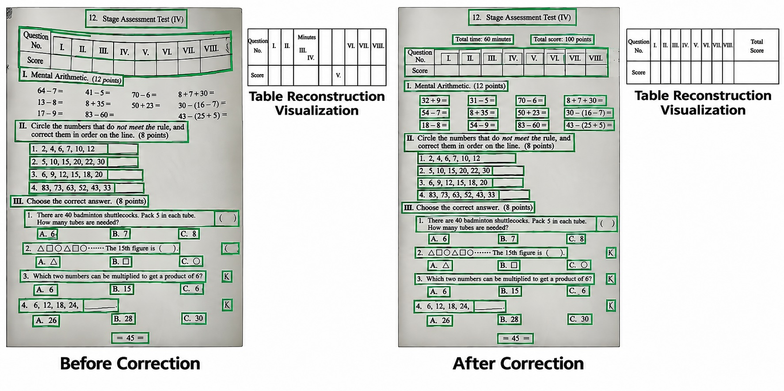
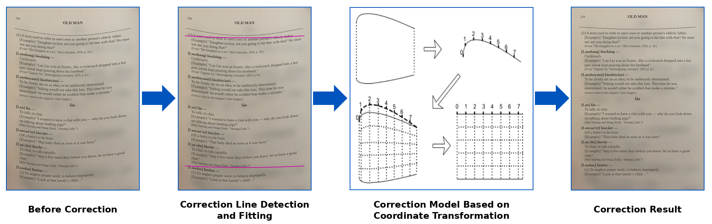
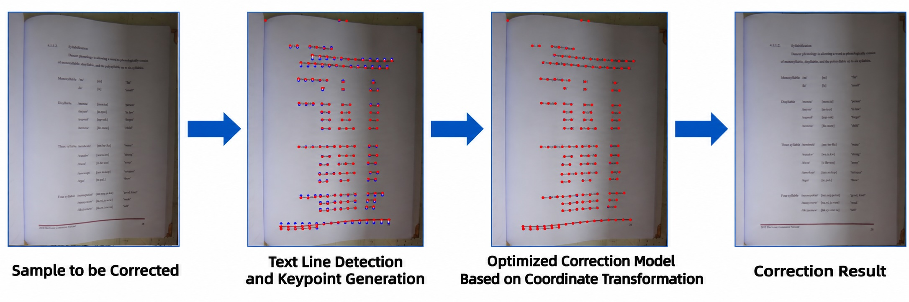
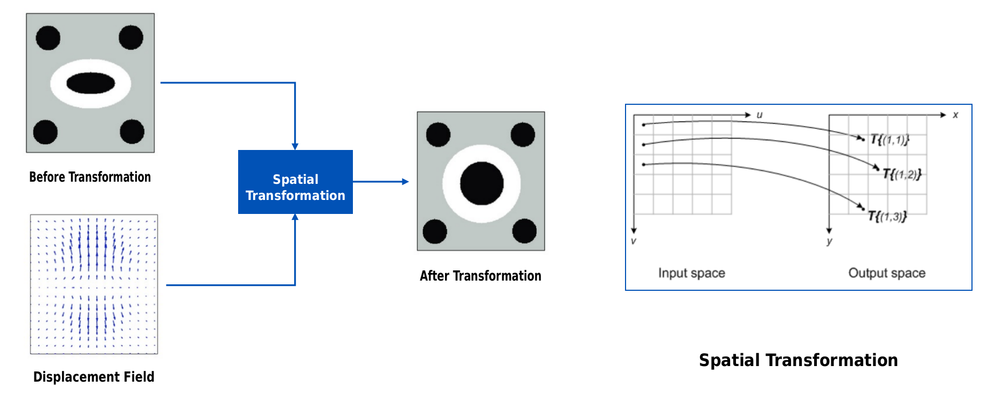
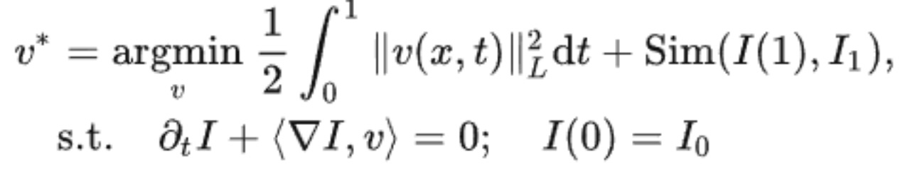

{/* content:metadata:start */}
[Back to Blog](/news/list)

Technical · xParse · Nov 20, 2026
{/* content:metadata:end */}

As electronic documents offer advantages in archiving, editing, signing, and sharing, document digitization has become increasingly widespread. Meanwhile, with the growing availability of high-quality cameras on mobile devices such as smartphones, capturing documents digitally using mobile devices has become commonplace.

Although mobile devices make it easy for anyone to capture document images, they also introduce greater variability in image quality and characteristics. Common issues in document image processing include page warping, shadow occlusion, moiré patterns, image blurring, and unclear text. These distortions hinder intelligent document processing and make downstream tasks such as OCR, information extraction, layout analysis, and reconstruction more challenging.

In this article, we focus on document image dewarping, an image processing technique that corrects geometric distortions, such as page curvature, in document images, and explore its development and emerging approaches.

First, let's examine why document image dewarping is important for downstream intelligent processing tasks such as OCR and information extraction.

<Frame caption="Figure 1: Comparison of Document Image Dewarping">
  
</Frame>

As shown in Figure 1, the same parsing engine produces significantly different table extraction results before and after document image dewarping. This demonstrates that document image dewarping plays a critical role in obtaining accurate information from document images.

To address document image dewarping challenges, researchers have developed various approaches.

Before 2015, mainstream methods primarily relied on text-line fitting and coordinate transformation. These methods detected text lines, fitted them using mathematical models, and transformed their coordinates to make the lines horizontal or vertical.

However, the performance of these document image dewarping methods depended heavily on the accuracy of text-line detection. They were sensitive to document layout, image clarity, and the regularity of text arrangements. They also struggled to process documents containing large numbers of charts and tables. Furthermore, incorrectly detected text lines could significantly interfere with the process.

<Frame caption="Figure 2: Text-Line-Based Coordinate Transformation for Document Image Dewarping">
  
</Frame>

To overcome these limitations, improved methods based on text-line fitting were proposed. These approaches use iterative optimization with a loss function to gradually obtain document image dewarping results. However, they are time-consuming and therefore unsuitable for real-time applications.

<Frame caption="Figure 3: Optimized Text-Line-Based Coordinate Transformation Method">
  
</Frame>

Since 2019, learning-based approaches have become increasingly popular, driven by the availability of large datasets.

Data-driven displacement-field learning uses deep learning to estimate displacement fields directly from data. Its core principle is to use neural networks to model and predict displacement fields, enabling high-accuracy estimation of document deformation.

<Frame caption="Figure 4: Displacement-Field Learning-Based Method">
  
</Frame>

Das et al. [2] were the first to introduce convolutional neural networks (CNNs) to this task. They used CNNs to detect document folds and divided documents into multiple blocks for document image dewarping. This approach can address simple deformations and documents with uniform backgrounds.

Ma et al. [4] proposed a stacked U-Net architecture trained to predict the forward mapping of warped documents in an end-to-end manner.

Das et al. [1] observed that document image dewarping models do not always perform well when trained exclusively on synthetic datasets containing only 2D deformations. To address this limitation, they created the Doc3D dataset, which contains various types of pixel-level displacement fields for document images and combines real-world document images with rendered images.

Feng et al. [3] adopted Transformer [5] as their network architecture, achieving further performance improvements. However, these approaches still have limitations in terms of document image dewarping performance in real-world applications.

Drawing on the fluid model used in image registration, INTSIG models the deformation field using a velocity field and employs an integration layer to obtain the final deformation field.

In fact, a displacement field can also be regarded as a flow field with fixed trajectories, where each trajectory follows a straight line. Under different regularization terms, straight-line trajectories are not optimal in most cases. The regularization terms associated with straight-line trajectories often have higher values.

By contrast, introducing a velocity field provides greater degrees of freedom in these situations.

A simple analogy helps illustrate this concept: the shortest path between two locations on a world map is generally not a straight line.

The velocity field estimation can be formulated as the following optimization problem, where L represents the regularization term applied to the velocity field:

Spatial Transformer Networks were initially introduced for relatively simple transformations, such as affine transformations. Later, the adoption of sampling grids made these networks considerably more powerful.

For a two-dimensional image with dimensions [W, H], the corresponding displacement field has dimensions [W, H, 2]. The displacement field represents the displacement of each pixel along the x and y axes.

Based on the displacement field, the Spatial Transformer Network generates a normalized sampling grid and then uses this grid to sample the image, producing the corrected result.

INTSIG's document image dewarping solution can process complex document images, helping improve OCR performance and enhance intelligent image processing. Its algorithms support end-to-end optimization and real-time processing across a wide range of scenarios. Advances in data resources and computational capabilities provide a foundation for algorithm optimization, enabling greater accuracy and more stable performance in complex scenarios. These capabilities provide reliable image-preprocessing support for AI automation and intelligent systems.

**References**

[1] Sagnik Das, Ke Ma, Zhixin Shu, Dimitris Samaras, and Roy Shilkrot. 2019. DewarpNet: Single-image document unwarping with stacked 3D and 2D regression networks. In ICCV. 131–140.

[2] Sagnik Das, Gaurav Mishra, Akshay Sudharshana, and Roy Shilkrot. 2017. The common fold: utilizing the four-fold to dewarp printed documents from a single image. In DocEng. 125–128.

[3] Hao Feng, Yuechen Wang, Wengang Zhou, Jiajun Deng, and Houqiang Li. 2021. DocTr: Document image transformer for geometric unwarping and illumination correction. In ACM MM. 273–281.

[4] Ke Ma, Zhixin Shu, Xue Bai, Jue Wang, and Dimitris Samaras. 2018. DocUNet: Document image unwarping via a stacked U-Net. In CVPR. 4700–4709.

[5] Ashish Vaswani, Noam Shazeer, Niki Parmar, Jakob Uszkoreit, Llion Jones, Aidan N. Gomez, Łukasz Kaiser, and Illia Polosukhin. 2017. Attention is all you need. In NeurIPS. 5998–6008.

<Card title="Explore xParse for structured documents" href="https://www.textin.ai/xparse">
  Preserve the information your downstream AI application needs.
</Card>

---

## Keep exploring

<CardGroup cols={2}>
  <Card title="TextIn xParse Is Now Available as a WorkBuddy Connector" href="/news/textin-xparse-is-now-available-as-a-workbuddy-connector">
    xParse · Announcements
  </Card>

  <Card title="RAGFlow x TextIn Integration 2.0 Is Now Live" href="/news/ragflow-x-textin-integration-2-0-high-quality-pdf-parsing-and-flexible-parser-switching">
    xParse · Announcements
  </Card>
</CardGroup>

{/* content:footer:start */}

[Back to Blog](/news/list)

<Card title="Put document AI to work." href="https://www.textin.ai/contact" cta="Talk to our team">
</Card>

{/* content:footer:end */}
