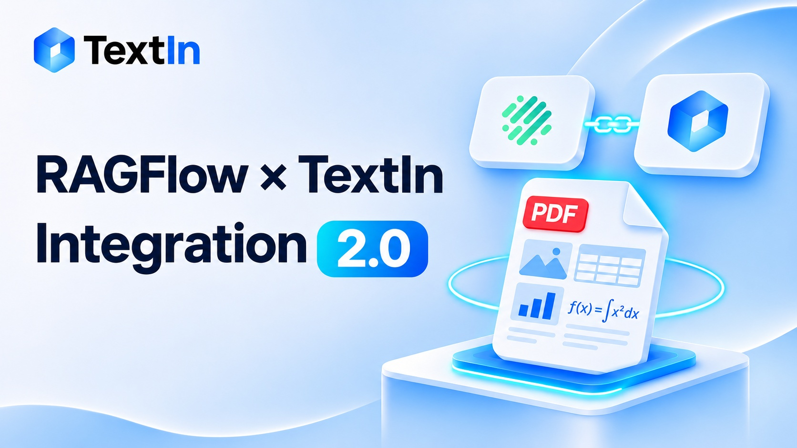

<section className="collection-hero">
<h1>Latest articles &amp; product updates</h1>
Engineering deep dives and practical guides on document parsing, table and form extraction, and retrieval-ready data preparation.

</section>

<section id="catalog" data-content-catalog data-kind="news" data-filter-key="category" data-default-category="" data-default-product="" data-default-sort="recommended" data-page-size="5" data-initial-page="1" data-catalog-index="[&#123;&quot;page&quot;:&quot;news/20260806165623929&quot;,&quot;category&quot;:&quot;Technical&quot;,&quot;products&quot;:[&quot;xParse&quot;],&quot;scenarios&quot;:[],&quot;date&quot;:&quot;2026-08-07&quot;,&quot;search&quot;:&quot;Technical Intelligent Exam Paper Parsing: A Practical Guide to Automated Question Extraction  Built with TextIn xParse and LLMs, this solution extracts question groups, question stems, tables, and images, with cross-page reconstruction and structured JSON output for question banks and digital learning. xParse 4 min read&quot;,&quot;chunk&quot;:1&#125;,&#123;&quot;page&quot;:&quot;news/20260805101419355&quot;,&quot;category&quot;:&quot;Announcements&quot;,&quot;products&quot;:[&quot;xParse&quot;],&quot;scenarios&quot;:[],&quot;date&quot;:&quot;2026-08-05&quot;,&quot;search&quot;:&quot;Announcements TextIn xParse Is Now Available as a WorkBuddy Connector TextIn xParse is now available as a WorkBuddy connector, enabling high-accuracy structured parsing of complex documents. It can process 100-page PDFs in approximately 2 seconds, helping AI agents understand documents and automate tasks. xParse 4 min read&quot;,&quot;chunk&quot;:1&#125;,&#123;&quot;page&quot;:&quot;news/20260416141504142&quot;,&quot;category&quot;:&quot;Technical&quot;,&quot;products&quot;:[&quot;xParse&quot;],&quot;scenarios&quot;:[],&quot;date&quot;:&quot;2026-04-16&quot;,&quot;search&quot;:&quot;Technical RAGFlow x TextIn Integration 2.0: High-Quality PDF Parsing and Flexible Parser Switching The updated RAGFlow x TextIn integration brings high-quality PDF parsing to RAG systems, with flexible parser switching and a step-by-step guide to deployment, configuration, and usage. xParse 4 min read&quot;,&quot;chunk&quot;:1&#125;,&#123;&quot;page&quot;:&quot;news/20261112102330592&quot;,&quot;category&quot;:&quot;Announcements&quot;,&quot;products&quot;:[&quot;xParse&quot;],&quot;scenarios&quot;:[],&quot;date&quot;:&quot;2026-11-12&quot;,&quot;search&quot;:&quot;Announcements TextIn xParse Is Now Available on DeepSeek Harness, Bringing Professional Document Parsing to Agent Development The TextIn xParse plugin is now available on DeepSeek Harness! Combining Tool, Skill, and CLI, it brings document parsing, content retrieval, and task management to Agent workflows. xParse 4 min read&quot;,&quot;chunk&quot;:1&#125;]">

<button type="button" data-category-filter="" aria-pressed="true">All articles</button>
<label className="catalog-search"><svg width="18" height="18" viewBox="0 0 24 24" fill="none" stroke="currentColor" strokeWidth="1.6" aria-hidden="true"><circle cx="10.5" cy="10.5" r="6.5"/><path d="m16 16 4 4"/></svg><input type="search" data-content-search placeholder="Search articles" aria-label="Search articles" /></label>

4 articles

<select data-product-filter aria-label="Filter by product"><option value="">All products</option></select><select data-content-sort aria-label="Sort articles"><option value="recommended">Featured</option><option value="newest">Newest first</option><option value="oldest">Oldest first</option></select>

  <a className="content-link" href="/news/20260806165623929">
    

    

      
TechnicalAug 7, 2026

      <h2>Intelligent Exam Paper Parsing: A Practical Guide to Automated Question Extraction </h2>
      
Built with TextIn xParse and LLMs, this solution extracts question groups, question stems, tables, and images, with cross-page reconstruction and structured JSON output for question banks and digital learning.

      
4 min read

    

  </a>

  <a className="content-link" href="/news/20260805101419355">
    

    

      
AnnouncementsAug 5, 2026

      <h2>TextIn xParse Is Now Available as a WorkBuddy Connector</h2>
      
TextIn xParse is now available as a WorkBuddy connector, enabling high-accuracy structured parsing of complex documents. It can process 100-page PDFs in approximately 2 seconds, helping AI agents understand documents and automate tasks.

      
4 min read

    

  </a>

  <a className="content-link" href="/news/20260416141504142">
    

    

      
TechnicalApr 16, 2026

      <h2>RAGFlow x TextIn Integration 2.0: High-Quality PDF Parsing and Flexible Parser Switching</h2>
      
The updated RAGFlow x TextIn integration brings high-quality PDF parsing to RAG systems, with flexible parser switching and a step-by-step guide to deployment, configuration, and usage.

      
4 min read

    

  </a>

  <a className="content-link" href="/news/20261112102330592">
    

    

      
AnnouncementsNov 12, 2026

      <h2>TextIn xParse Is Now Available on DeepSeek Harness, Bringing Professional Document Parsing to Agent Development</h2>
      
The TextIn xParse plugin is now available on DeepSeek Harness! Combining Tool, Skill, and CLI, it brings document parsing, content retrieval, and task management to Agent workflows.

      
4 min read

    

  </a>

1–4 of 4

<a href="/news/list#catalog" data-catalog-page="previous" aria-disabled="true" tabIndex="-1">Previous</a><a href="/news/list#catalog" data-catalog-page="1" aria-current="page">1</a><a href="/news/list#catalog" data-catalog-page="next" aria-disabled="true" tabIndex="-1">Next</a>

Unable to load articles.
<button type="button" data-catalog-retry>Try again</button>

<h2>No articles found</h2><button type="button" data-content-reset>Clear filters</button>

</section>
<section className="resource-cta"><h2>Put document AI to work.</h2><a className="site-button" href="https://www.textin.ai/contact">Talk to our team</a></section>

